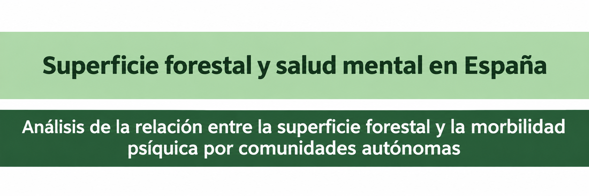
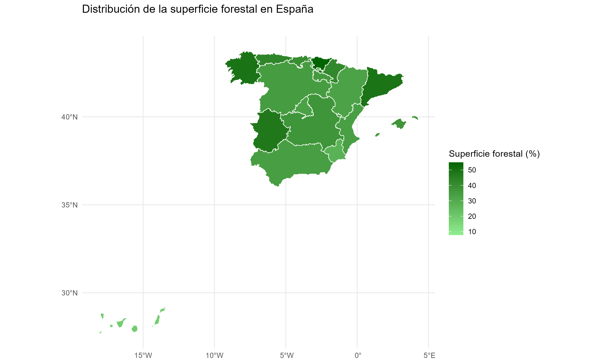
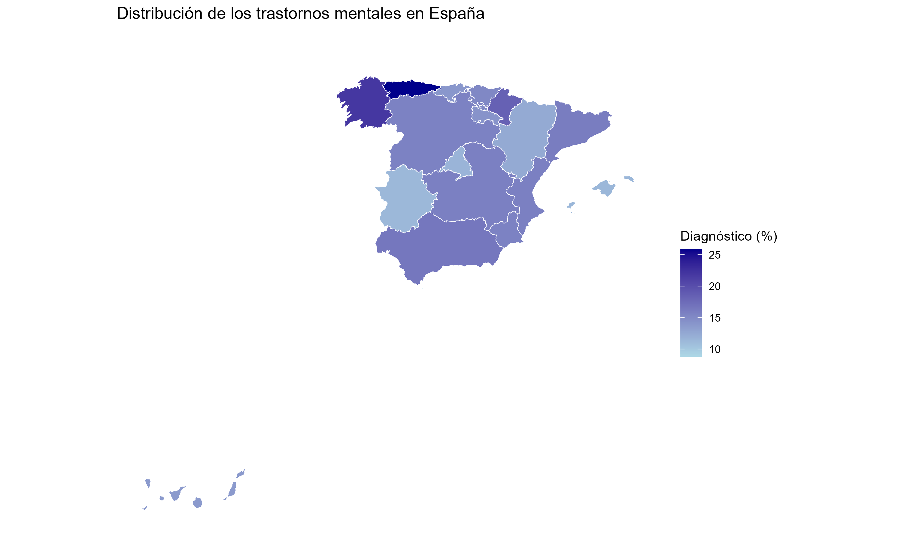
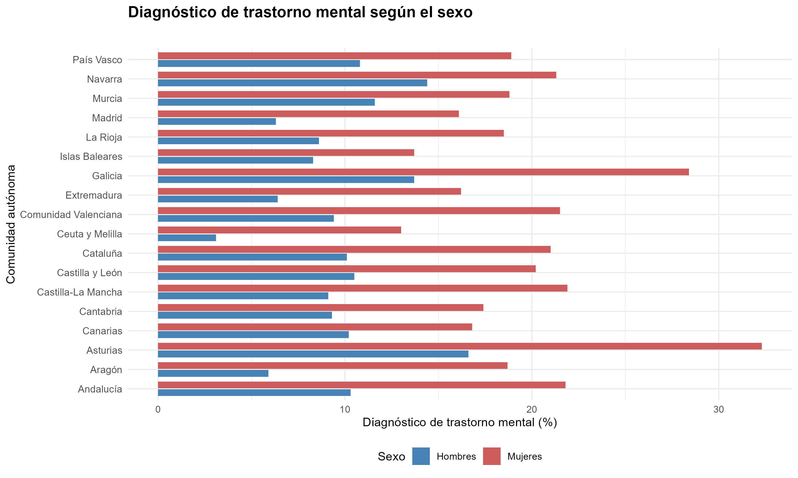
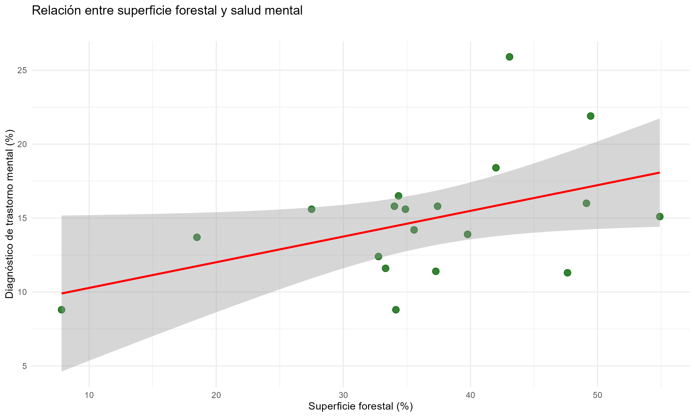
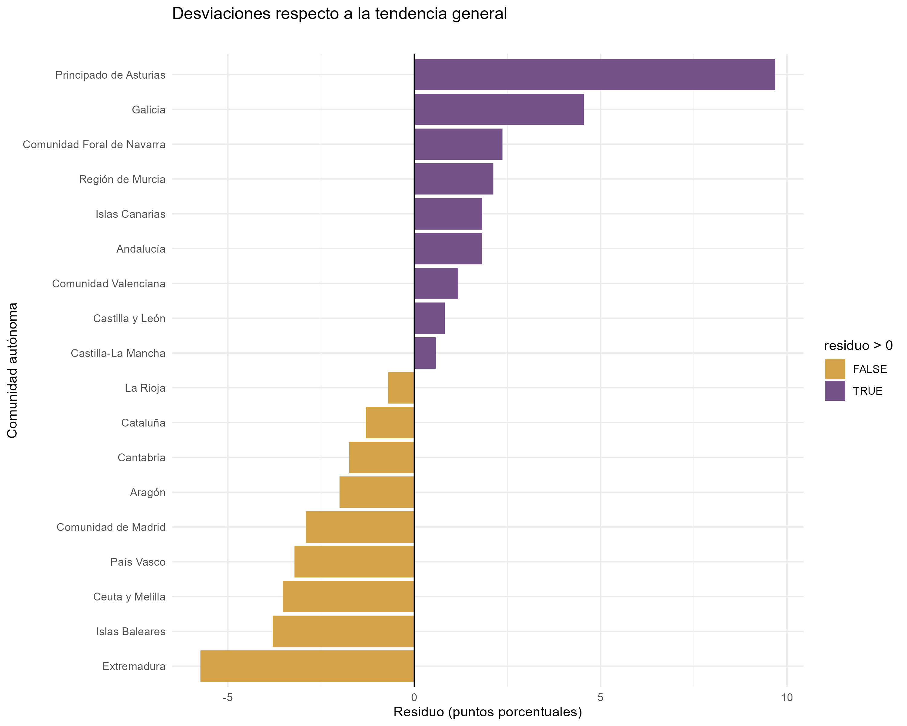

<div align="center">

<sub><b>UNIVERSIDAD DE BURGOS · INGENIERÍA DE LA SALUD</b></sub>



<p>&nbsp;</p>

<h4>Raúl Mozo · Mohamed Lambarki</h4>

</div>


<p>&nbsp;</p>

## Introducción

La relación entre el entorno natural y la salud mental constituye un tema de creciente interés en el ámbito de la salud pública. La presencia de espacios naturales podría estar asociada con el bienestar psicológico de la población, aunque esta relación depende de numerosos factores.

En este proyecto se pretende explorar la posible asociación entre la superficie forestal y la morbilidad psíquica en las distintas comunidades autónomas de España, considerando también el sexo de la población como una variable relevante.

Para ello, se utilizarán conjuntos de datos procedentes de fuentes estadísticas oficiales, que serán procesados y analizados mediante R y RStudio.

<div style="height: 30px;"></div>

## Objetivos

Analizar la posible relación entre la superficie forestal y la morbilidad psíquica en las distintas comunidades autónomas de España, considerando el sexo de la población como una variable adicional que puede influir en dicha relación, a través de:

- Analizar la distribución de la superficie forestal
- Estudiar la morbilidad psíquica
- Explorar la relación entre la superficie forestal y la morbilidad psíquica
- Evaluar el papel de la edad de la población

<div style="height: 30px;"></div>

## Estructura del seminario

El repositorio está organizado en diferentes carpetas y archivos para facilitar el acceso a los datos, el código y los resultados del estudio.

```text
Seminario-Fuentes-de-Datos/
├── README.md
├── README.html
├── Seminario.Rmd
├── Seminario.html
├── INPUT/
│   ├── CSS/
│   ├── DATA/
│   └── IMAGES/
├── OUTPUT/
└── Scripts/
```

- **README.md:** Presentación general del proyecto.
- **README.html:** Versión HTML del README que presenta la información general del proyecto.
- **Seminario.Rmd:** Desarrollo del estudio, incluyendo código, análisis y resultados.
- **Seminario.html:** Versión final del trabajo generada mediante R Markdown.
- **INPUT/DATA:** Conjuntos de datos utilizados.
- **OUTPUT:** Gráficos y resultados obtenidos.
- **Scripts:** Código auxiliar empleado durante el análisis.

<div style="height: 30px;"></div>

## Resultados

<div style="height: 30px;"></div>

<table width="100%" style="border-collapse: separate; border-spacing: 40px 25px;">
  <tr>
    <td width="48%" align="center">
      
      <p style="margin-top: 20px;"><b>Distribución de la superficie forestal</b></p>
    </td>
    <td width="48%" align="center">
      
      <p style="margin-top: 20px;"><b>Distribución de los trastornos mentales</b></p>
    </td>
  </tr>

  <tr>
    <td colspan="2" height="35"></td>
  </tr>

  <tr>
    <td align="center">
      
      <p style="margin-top: 20px;"><b>Diagnóstico de trastorno mental según el sexo</b></p>
    </td>
    <td align="center">
      
      <p style="margin-top: 20px;"><b>Relación entre superficie forestal y salud mental</b></p>
    </td>
  </tr>

  <tr>
    <td colspan="2" height="35"></td>
  </tr>

  <tr>
    <td colspan="2" align="center">
      
      <p style="margin-top: 20px;"><b>Desviaciones respecto a la tendencia general</b></p>
    </td>
  </tr>
</table>

<div style="height: 30px;"></div>

## Conclusiones

Los resultados obtenidos no muestran una relación clara entre una mayor superficie forestal y una mejor salud mental en las comunidades autónomas de España. Las diferencias territoriales observadas sugieren que esta relación es compleja y que una mayor proporción de superficie forestal no implica necesariamente un menor porcentaje de diagnósticos de trastornos mentales.

<div style="height: 30px;"></div>

## Acceso al seminario completo

- [Seminario.Rmd](Seminario.Rmd)
- [Seminario.html](Seminario.html)
